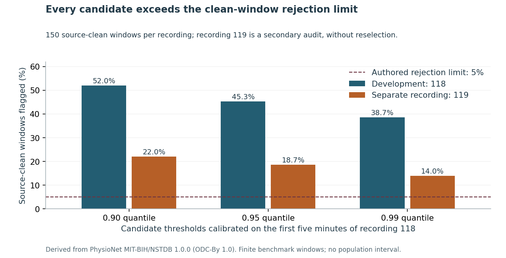

# Test false rejections before using an ECG quality gate

An ECG noise check can catch many noisy windows and still discard too much source-clean signal. This repository tests that tradeoff before treating a quality flag as useful.

**Finding:** all three authored candidate rules fail the fixed **5% source-clean rejection limit**. Even the least aggressive rejects **58 of 150** later source-clean development windows (**38.7%**); the others reject 45.3% and 52.0%. The declared selection rule keeps the **accept-all fallback**, which provides no noise-detection improvement and does not certify any window as clean.



On a separate source recording, a secondary audit of the same rejected thresholds flags **14–22%** of source-clean windows. That result does not rescue the failed development constraint. No threshold is selected from the later recording. The practical recommendation is to keep these gates out of operational use and collect representative recordings and expert quality labels before choosing a replacement.

Read the [six-page independent study](paper/manuscript.pdf), inspect the [complete development search](results/development/metrics.csv), or try the [implementation exercise](exercise/README.md):

```sh
python -m pip install numpy==2.2.5
python src/check_window.py examples/authored_window.csv --sample-rate 360 --units mV
python src/check_window.py examples/authored_window.csv --sample-rate 360 --units mV --candidate q099
```

The committed example is an authored alternating-value numerical fixture, without a physiological interpretation. The first command uses the frozen fallback. The optional candidate command explicitly inspects an already rejected rule. Output reports a demonstration flag, features and reasons; clinical quality remains unavailable. Flat, nonfinite, malformed or incorrect-length inputs return unavailable.

## Evidence underneath

- [Fixed protocol](PROTOCOL.md), [source attribution](DATA_RIGHTS.md), [native binding correction](NATIVE_BINDING_NOTE.md) and [recorded environment](ENVIRONMENT.md). Fourteen openly accessible benchmark records, 28 waveform/header files and nine integrity/metadata files were privately preserved. Every waveform/header SHA-256 matches the publisher inventory. No raw waveform, original header comment, demographic/medication record or protected clinical dataset is public.
- [Original reconciliation](data/original_verification.json): all 18,200,000 digital values and physical conversions agree with independent WFDB decoding. The source generator adds documented segment offsets; the corrected clean-segment shape check covers 8,812,800 cells. The failed absolute-voltage assertion is retained, with the binding committed before features. No waveform alignment, fitted offset correction or scale is applied.
- [Development](data/features_development.csv) and [later](data/features_later.csv) projections each contain 648 rows and 3,888 numerical feature values, checked in 10,391 independent WFDB/scalar/SQL conditions per recording. These derived inputs support offline analysis replay; raw re-extraction requires the separately preserved originals.
- Three fixed quantile candidates, the complete failed search and the accept-all fallback are retained. [Thirty-six dependencies](data/dependency_freeze.json) were committed before later features. [The development note](DEVELOPMENT.md) declares the secondary all-candidate later audit after development and before later features; it cannot change selection. [All predictions](results/later/predictions.csv), [noise strata](results/later/strata.csv) and [sensitivity flips](results/later/sensitivity.csv) remain inspectable.
- Independent metric/key checks cover 7,416 predictions per recording in 45,028 development and 45,029 later conditions. Twenty-seven finite test methods include extra parameterized cases. The three reviewed figures pass 765 value, 1,572 actual SVG-coordinate and nine hash checks. All 83 source-bound manuscript displays and every rendered page are checked. [Execution notes](EXECUTION_NOTES.md) preserve the repeated-development/runtime limitation. See [local review](REVIEW_RECEIPT.json), the [pull request](https://github.com/S3R3Bii/ecg-quality-gate-transfer/pull/2) and [Actions](https://github.com/S3R3Bii/ecg-quality-gate-transfer/actions) for current release evidence.

## Reproduce

```sh
python src/reproduce.py
```

The public numerical replay uses a full-history clone and separate output paths, verifies frozen bytes, reruns the tests and both analyses, compares deterministic exports and leaves original files unchanged. It fetches no source data and does not claim a fresh raw-waveform validation. Python 3.12 with the pinned requirements supports optional figure/PDF tools. The original-source check additionally requires WFDB 4.3.1 and the preserved source snapshots; see the environment and source requests. [LaTeX source](paper/main.tex) and all three figure PDFs accompany the manuscript.

## Use and limits

The two dimensionless checks measure adjacent-difference energy and one-second block-mean variation within a ten-second window. The finite grid, five-minute calibration, 5% limit and noise severity grouping are authored engineering assumptions. They are not calibrated clinical costs or validated quality labels. Both gain/offset and quantization changes are numerical exercises, not measurements from different devices.

Only one development and one later source recording are evaluated. Windows and noise variants share underlying signals, so hundreds of windows do not become hundreds of independent participants. There is no population confidence interval, clinical prevalence estimate, new quality index, downstream diagnostic model, device validation, deployment, alarm reduction, adoption or measured patient/financial benefit. This negative-result benchmark is independent and not peer reviewed. Separate formal-publication projects, including Azure optimization, remain private.
